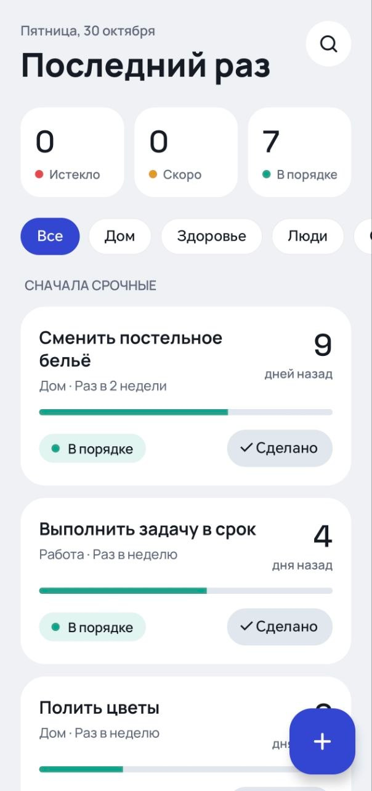
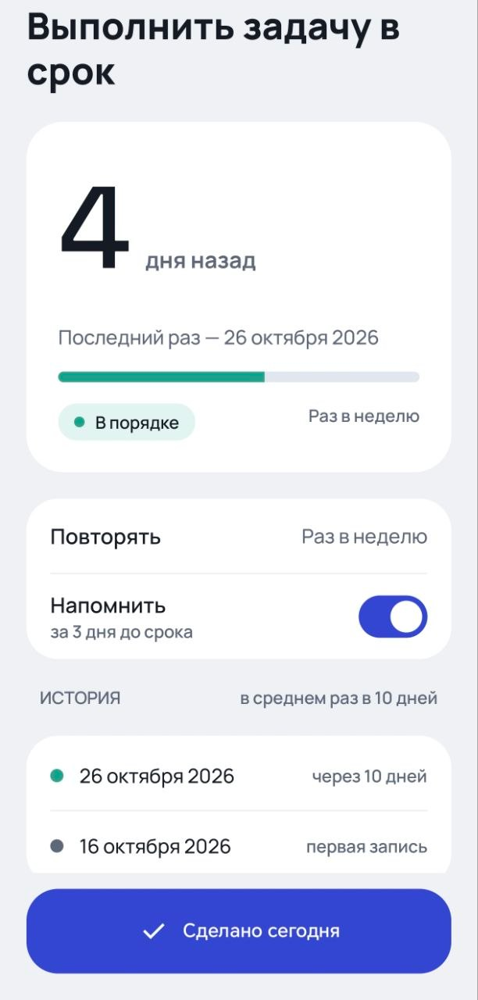
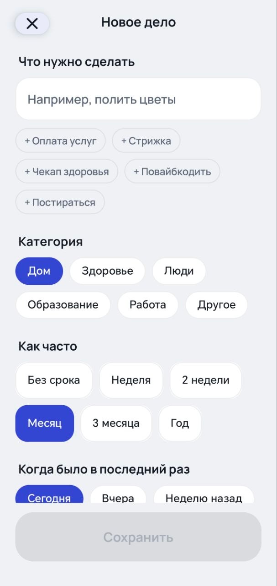
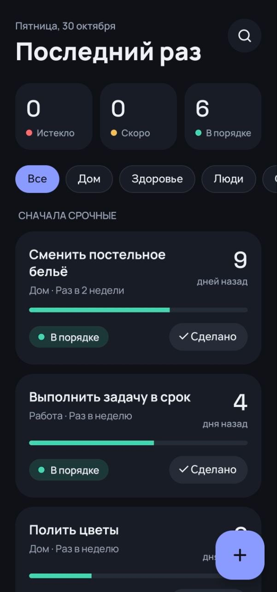

<p align="center">
  
</p>

<h1 align="center">Последний раз</h1>

<p align="center">
  Android-приложение для повторяющихся дел: помнит, когда вы последний раз что-то делали,<br/>
  и подсказывает, когда пора снова.
</p>

<p align="center">
  
  
  
</p>

\---

## Скриншоты

|Список|Дело|Новое дело|Тёмная тема|
|:-:|:-:|:-:|:-:|
|||||

## Зачем

Когда вы последний раз меняли зубную щётку? Фильтр для воды? Звонили бабушке?
Такие дела повторяются не каждый день, поэтому их легко забыть. Обычный список задач
не помогает: выполнил — вычеркнул навсегда. Здесь дело после отметки «Сделано»
начинает отсчёт заново, а приложение показывает, сколько времени прошло.

## Возможности

* Список дел с сортировкой по срочности: просроченные сверху
* Статусы цветом: 🟢 в порядке · 🟡 скоро · 🔴 просрочено
* Сводка вверху: сколько просрочено, скоро и в порядке
* Фильтр по категориям и поиск по названию
* Экран дела: сколько дней прошло, прогресс, история выполнений, средний интервал
* Создание дела с подсказками и выбором частоты
* Удаление с подтверждением
* Ежедневные напоминания за 3 дня до срока
* Кнопка «Сделано» прямо в уведомлении, без открытия приложения
* Светлая и тёмная тема, анимации переходов
* Данные хранятся только на телефоне, работает без интернета

## Стек

|Область|Технологии|
|-|-|
|Язык|Kotlin|
|UI|Jetpack Compose, Material 3, своя тема и типографика|
|Архитектура|MVVM + UDF (State / Command), разделение на слои data / domain / presentation|
|Асинхронность|Kotlin Coroutines, Flow, StateFlow|
|База данных|Room (транзакции, реактивные запросы через Flow)|
|Навигация|Navigation Compose с типобезопасными маршрутами|
|Фоновая работа|WorkManager (CoroutineWorker, периодическая задача)|
|Системное|Notifications, NotificationChannel, PendingIntent, BroadcastReceiver|
|DI|ручной контейнер зависимостей (`AppContainer`)|
|Тесты|JUnit 4, kotlinx-coroutines-test, fake-репозиторий|

## Архитектура

```
presentation   экраны (Compose) + ViewModel
     │  State ↓        ↑ Command
     ▼
domain         модели (Task, Category, TaskStatus), StatusCalculator,
               интерфейс TaskRepository — чистый Kotlin без Android
     ▲
     │ реализует
data           Room: Entity, Dao, AppDatabase, маппер, TaskRepositoryImpl
```

* **Однонаправленный поток данных.** Экран получает `State` и отправляет `Command`;
вся логика — во ViewModel.
* **Единый источник правды — база.** ViewModel подписана на `Flow` из Room:
после «Сделано» база обновляется, и все экраны получают новые данные автоматически.
* **`domain` не зависит ни от чего.** Логика статусов — чистые функции, поэтому легко тестируется.
* **Репозиторий — интерфейс.** В приложении — реализация на Room, в тестах — `FakeTaskRepository`.

## Структура

```
app/src/main/java/com/gorbkostya/lasttime/
├── data/            Room, маппер, репозиторий, тестовые данные первого запуска
├── di/              AppContainer
├── domain/          модели, StatusCalculator, TaskRepository
├── notifications/   ReminderWorker, ReminderNotifier, DoneReceiver
└── presentation/
    ├── components/  TaskCard, StatusPill, StatTile, CategoryChip, ProgressBar…
    ├── list/        главный экран
    ├── detail/      экран дела
    ├── edit/        создание дела
    ├── navigation/  маршруты и NavHost
    └── theme/       цвета, типографика, тема
```

## Тесты

```bash
./gradlew test
```

* `StatusCalculatorTest` — расчёт статуса и прогресса, включая граничные значения (75 %, ровно в срок, без срока)
* `ListViewModelTest` — фильтр, поиск, отметка «Сделано»
* `NewTaskViewModelTest` — валидация и сохранение
* `DetailViewModelTest` — удаление

## Сборка

1. Android Studio (последняя стабильная версия), JDK 17+
2. Открыть проект, дождаться синхронизации Gradle
3. Запустить конфигурацию `app` на устройстве или эмуляторе с Android 9+

Готовый APK — в разделе [Releases](../../releases).

## Что можно улучшить

* Редактирование дела
* Отмена удаления через Snackbar вместо диалога
* Выбор времени напоминания
* Виджет на рабочий стол
* Hilt вместо ручного DI
* UI-тесты на Compose

## Автор

k1rmflyy — [GitHub](https://github.com/ВАШ_НИК)

